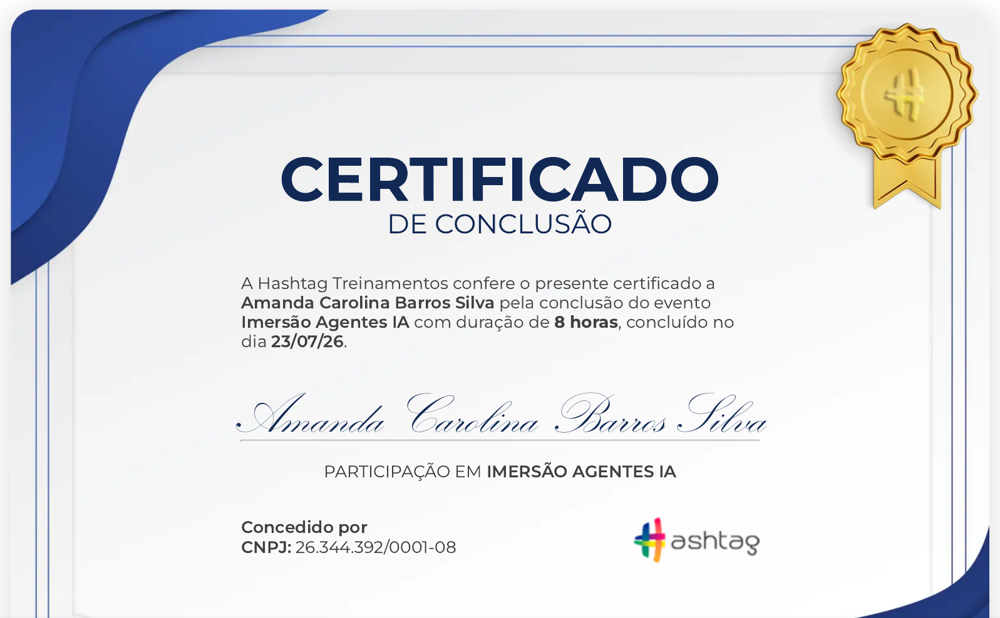

# Meus Projetos n8n

Automações e agentes de IA que construí com n8n. Cada pasta tem um projeto, com README, prints e o `workflow.json` para importar.

## Projetos

| Projeto | O que faz | Ferramentas |
|---|---|---|
| [chat-basico](./chat-basico) | Agente de chat com memória e ferramentas de cálculo e pesquisa | n8n, Groq, Google Sheets, Wikipedia |
| [assistente-whatsapp-estudos](./assistente-whatsapp-estudos) | Assistente de estudos no WhatsApp, com comando `/quiz` e busca na web | n8n, Groq, Z-API, SerpApi, Google Sheets |
| [agente-analise-reembolso](./agente-analise-reembolso) | Faz a triagem de pedidos de reembolso fora do prazo e avisa a equipe nos casos que precisam de atenção | n8n, Gemini, Google Sheets, Gmail, Telegram |

## Como um projeto levou ao outro

Comecei pelo agente de chat para entender as três peças de um agente no n8n: modelo, memória e ferramentas. Depois levei essa mesma base para o WhatsApp, o que me obrigou a lidar com webhook, uma API externa e comandos personalizados. No agente de reembolso o objetivo mudou: em vez de conversar, a IA precisava apoiar uma decisão de negócio, e aí entraram regras, classificação de clientes e mais de um canal de resposta.

## Como usar

1. Escolha a pasta do projeto
2. No n8n, importe o `workflow.json` em Menu > Import from File
3. Configure suas credenciais (cada README diz quais)
4. Ative o workflow

## Certificado

Imersão Agentes IA, da Hashtag Treinamentos (8 horas), concluída em 23/07/2026.

---

Amanda Carolina · [LinkedIn](https://www.linkedin.com/in/amanda-carolina-bs)
