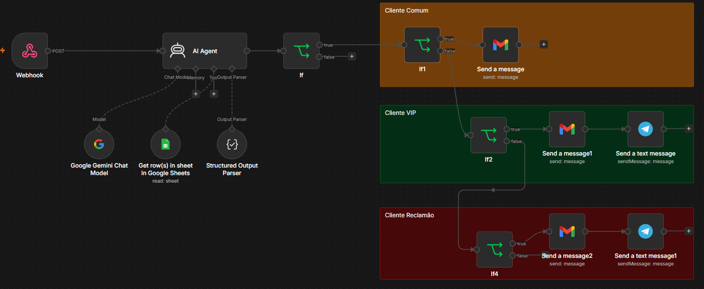
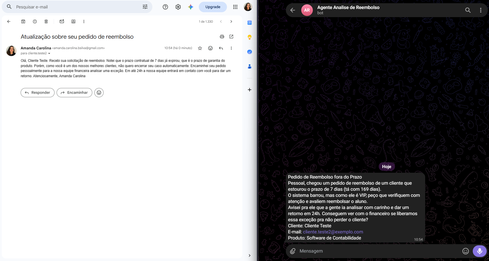
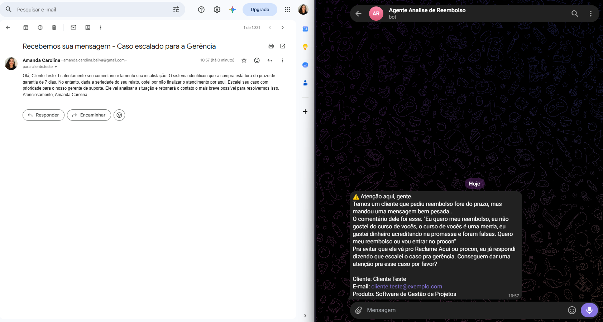

# Agente de Análise de Reembolso

Um agente que faz a triagem dos pedidos de reembolso de uma empresa (fictícia) de cursos online. Ele lê o pedido, cruza com o histórico do cliente, classifica o caso e decide a resposta: um e-mail automático para o cliente e, quando o caso pede atenção, um alerta para a equipe no Telegram.

A ideia veio da Imersão Agentes IA, da Hashtag Treinamentos. Nos dois projetos anteriores ([Agente de Chat](../chat-basico) e [Assistente via WhatsApp](../assistente-whatsapp-estudos)) a IA conversava. Aqui ela apoia uma decisão de negócio.

**Ferramentas:** n8n, Google Gemini, Tally (formulário), Google Sheets, Gmail e Telegram

## O problema

A empresa vende cursos de softwares de contabilidade, gestão de projetos, edição de vídeo, criação de sites e CRM. O cliente tem 7 dias para pedir reembolso. Depois disso perde o direito, mas na prática muita gente insatisfeita pede mesmo assim.

Os pedidos dentro do prazo já são reembolsados normalmente. Este agente cuida só dos que chegam depois dos 7 dias, que são justamente os que exigem algum critério: negar um pedido de um cliente que gastou muito pode significar perder esse cliente, e responder friamente alguém muito irritado pode acabar no Reclame Aqui.

## Como o agente decide

Separei o trabalho em duas partes. A IA não decide nada. Ela só lê e organiza as informações. Quem decide são as regras do workflow.

**1. A IA extrai e organiza os dados.** O AI Agent lê a resposta do formulário e a planilha de clientes e devolve um JSON com:

- nome, e-mail, produto e comentário do formulário
- o sentimento do comentário: `positivo`, `neutro`, `negativo` ou `muito_negativo`
- se o cliente foi encontrado na planilha, o nome completo e o total que ele já gastou
- quantos dias se passaram desde a última compra

Para o sentimento, defini critérios objetivos. `muito_negativo` é agressividade, xingamento, ameaça de Procon, Reclame Aqui ou processo, ou texto em caixa alta. Na dúvida entre `negativo` e `muito_negativo`, o prompt manda escolher `negativo`, para não escalar casos à toa.

**2. As regras do workflow classificam e respondem.** Com o JSON pronto, os nodes If separam três situações:

- **Cliente comum** (fora do prazo, não é VIP e não está muito irritado): recebe um e-mail automático dizendo que o prazo expirou. A equipe não é acionada.
- **Cliente VIP** (já gastou mais de R$ 3.000 no total): recebe um e-mail dizendo que o pedido foi encaminhado para análise, e a equipe recebe um alerta no Telegram para avaliar uma exceção com o financeiro.
- **Cliente insatisfeito** (sentimento `muito_negativo`): recebe um e-mail dizendo que o caso foi levado à gerência, e a equipe recebe um alerta de prioridade, para evitar uma reclamação pública.

## Estrutura do workflow

| Node | Função |
|---|---|
| Webhook | Recebe a resposta do formulário do Tally |
| AI Agent + Google Gemini Chat Model | Lê o pedido e monta o JSON |
| Get row(s) in sheet | Busca o histórico do cliente na planilha |
| Structured Output Parser | Garante que o JSON venha no formato esperado |
| If, If1, If2 e If4 | Classificam o caso |
| Send a message (Gmail) | Responde o cliente |
| Send a text message (Telegram) | Avisa a equipe |

## As mensagens

A equipe só é avisada no Telegram nos casos VIP e de cliente insatisfeito. Escrevi os alertas no tom de uma conversa entre colegas.

Alerta de cliente VIP:

> Pessoal, chegou um pedido de reembolso de um cliente que estourou o prazo de 7 dias (tá com X dias). O sistema barrou, mas como ele é VIP, peço que verifiquem com atenção e avaliem reembolsar o aluno. Avisei pra ele que a gente ia analisar com carinho e dar um retorno em 24h. Conseguem ver com o financeiro se liberamos essa exceção pra não perder o cliente?

Alerta de cliente insatisfeito:

> Atenção aqui, gente. Temos um cliente que pediu reembolso fora do prazo, mas mandou uma mensagem bem pesada. Pra evitar que ele vá pro Reclame Aqui ou Procon, eu já respondi dizendo que escalei o caso pra gerência. Conseguem dar uma atenção pra esse caso, por favor?

Os dois alertas terminam com nome, e-mail e produto do cliente.

Os e-mails para o cliente seguem a mesma lógica:

- **Cliente comum:** explica que a compra passou dos 7 dias de garantia e que por isso o reembolso não é possível.
- **Cliente VIP:** diz que o prazo expirou, mas que, por ser um dos melhores clientes, o pedido foi encaminhado ao financeiro para avaliar uma exceção, com retorno em até 24h.
- **Cliente insatisfeito:** diz que, pela seriedade do relato, o atendimento não foi encerrado ali e o caso foi levado com prioridade ao gerente de suporte.

Os textos completos estão no workflow, com o nome do cliente preenchido por variável.

## O prompt

O prompt segue uma ordem fixa: extrair os campos do formulário, buscar o cliente na planilha pelo e-mail (normalizado, sem inventar dados se não encontrar), calcular os dias desde a última compra a partir de `{{ $now }}`, analisar o sentimento e devolver só o JSON, sem markdown. Deixei o formato rígido de propósito, porque é isso que permite ao Structured Output Parser validar a resposta antes de ela chegar nos Ifs.

## Formulário

O formulário de pedido de reembolso foi feito no Tally: [tally.so/r/rjbQWo](https://tally.so/r/rjbQWo)

## Prints

Estrutura do workflow:

Cliente comum, com resposta automática:

Cliente VIP, com a equipe avisada:

Cliente insatisfeito, com o caso escalado:

## O que aprendi

- Usar a IA para organizar informação e deixar a decisão para regras que eu controlo
- Usar o Structured Output Parser para ter respostas confiáveis e no formato certo
- Disparar mais de um canal (e-mail e Telegram) a partir da mesma lógica
- Usar o histórico de uma planilha para enriquecer a decisão, como no caso do cliente VIP
- Escrever prompts sem brechas quando a regra de negócio é sensível, como no reembolso

## Segurança e privacidade

Este workflow lida com dados de clientes (nome, e-mail e histórico de compras). O `workflow.json` publicado aqui usa valores genéricos no lugar das credenciais, do ID da planilha e do grupo do Telegram, e os prints não mostram dados reais.

## Como usar

1. Importe o `workflow.json` no n8n (Menu > Import from File)
2. Configure suas credenciais do Gemini, Google Sheets, Gmail e Telegram
3. Troque o link do formulário do Tally pelo seu, ou use outro formulário
4. Ajuste os critérios, como o valor que define um cliente VIP, para a realidade do seu negócio

---

Projeto anterior: [Assistente de Estudos via WhatsApp](../assistente-whatsapp-estudos).
