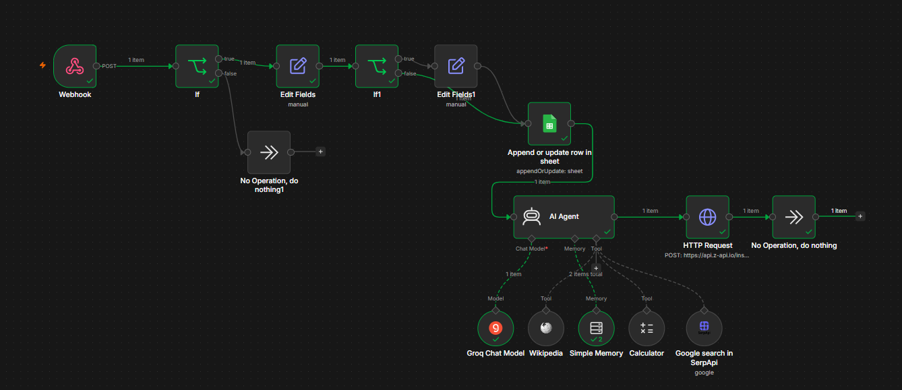
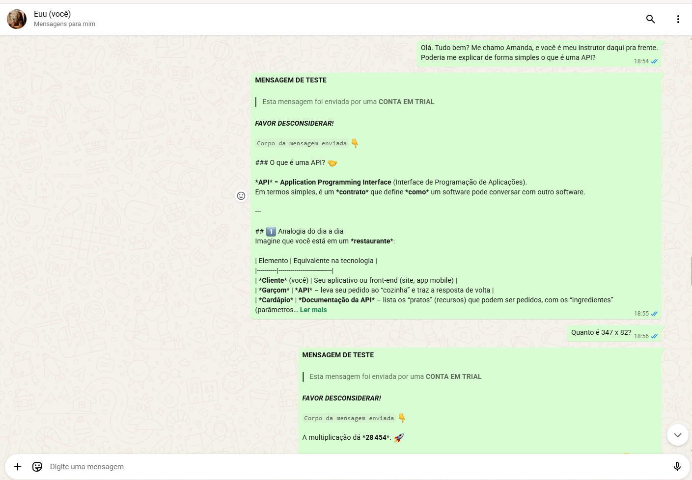
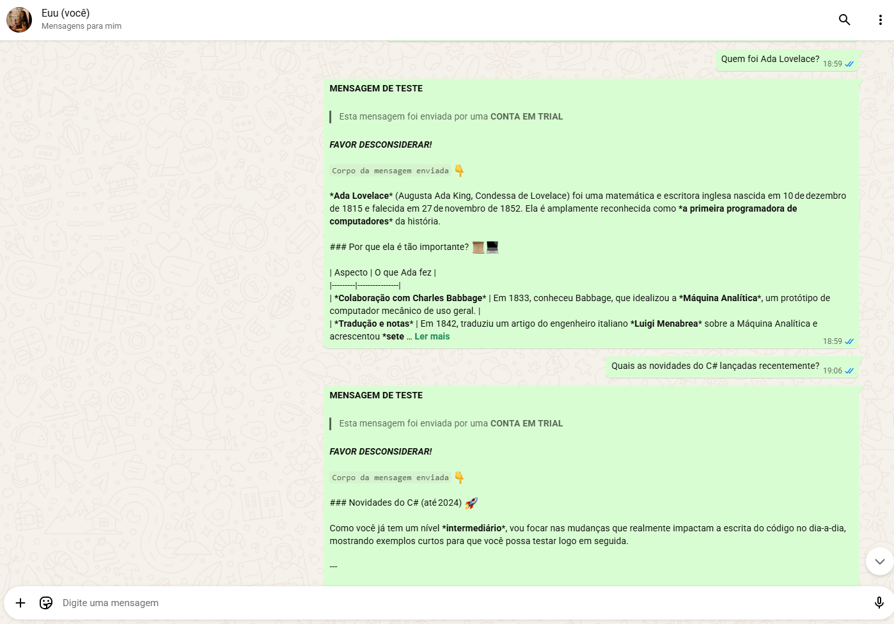
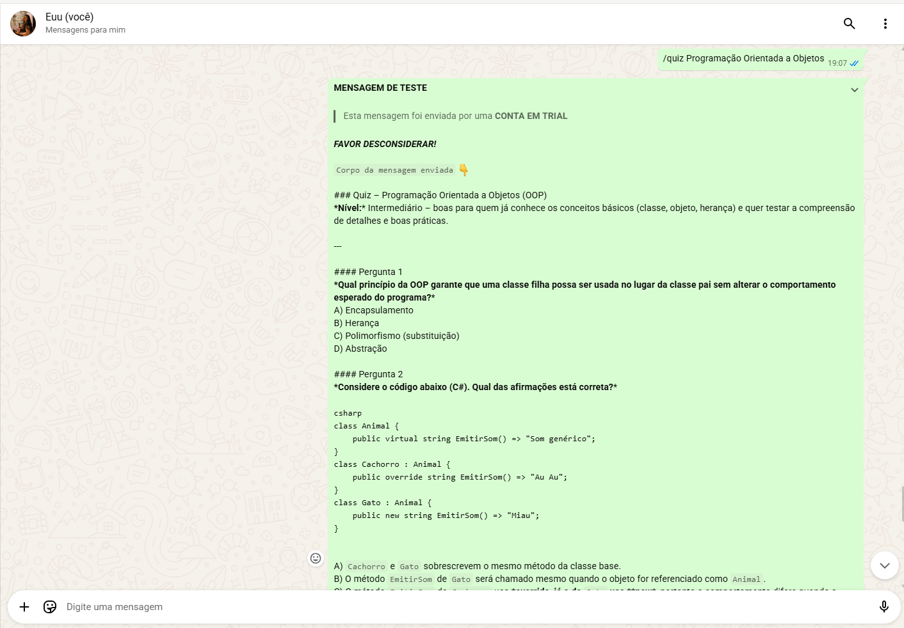
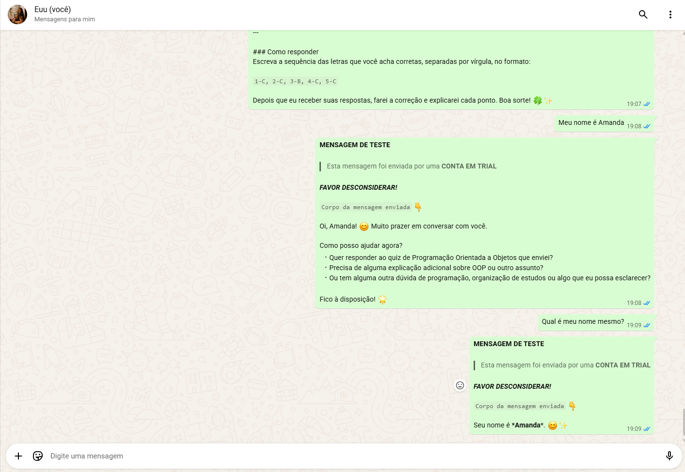

# Assistente de Estudos via WhatsApp

Um assistente que responde pelo WhatsApp dúvidas de estudo, cursos e programação. Escolhi o WhatsApp porque é o que está sempre na mão: estudar direto por ele fica fácil, pelo menos para a parte de teoria e leitura.

Parti da estrutura do [Agente de Chat](../chat-basico) e acrescentei a integração com o WhatsApp pela Z-API, busca na web e um comando `/quiz` que gera perguntas sobre qualquer tema.

**Ferramentas:** n8n, Groq (`openai/gpt-oss-120b`), Z-API, Google Sheets, SerpApi, Calculator e Wikipedia

## O que ele faz

- Recebe e responde mensagens no WhatsApp
- Lembra o contexto da conversa
- Registra o histórico numa planilha do Google Sheets
- Faz contas (Calculator), busca conceitos (Wikipedia) e procura informações atuais na web (SerpApi)
- Com `/quiz [tema]`, gera na hora uma pergunta de múltipla escolha com gabarito

## Como funciona

A Z-API manda cada mensagem recebida para um webhook do n8n. Um primeiro If valida a mensagem, e o Edit Fields separa o ID da conversa, o texto e o nome. Um segundo If confere se a mensagem começa com `/quiz`. Se começar, o fluxo tira o comando, pega o tema e monta um prompt pedindo que a IA crie direto uma pergunta com alternativas A, B, C e D e o gabarito, sem fazer perguntas antes. Se não começar, a mensagem segue o caminho normal de conversa.

Nos dois casos a conversa é salva no Sheets, o AI Agent responde usando as ferramentas que precisar, e um HTTP Request devolve a resposta para o WhatsApp pela Z-API.

| Node | Função |
|---|---|
| Webhook | Recebe as mensagens da Z-API |
| If | Valida a mensagem recebida |
| Edit Fields | Organiza ID da conversa, mensagem e nome |
| If1 | Confere se é um comando `/quiz` |
| Edit Fields1 | Monta o prompt do quiz |
| Append or update row in sheet | Salva a conversa |
| AI Agent, Groq Chat Model e Simple Memory | Respondem e guardam o histórico |
| Calculator, Wikipedia e SerpApi | Ferramentas do agente |
| HTTP Request | Envia a resposta de volta pela Z-API |

## Prints

Estrutura do workflow:

Explicando um conceito e fazendo uma conta:

Buscando na Wikipedia e na web:

Comando `/quiz` sobre Programação Orientada a Objetos:

Teste de memória, com o assistente lembrando o que foi dito antes:

## O que aprendi

- A diferença entre a URL de teste e a URL de produção do webhook no n8n
- Integrar o n8n com uma API externa de WhatsApp
- Usar o If para criar comandos dentro de um agente
- Ajustar o System Message para mudar o comportamento e as prioridades do agente

## Limitações

- Escolhi a Z-API porque dava para usar de graça no projeto. A contrapartida é que, na conta gratuita, toda mensagem enviada sai com o aviso "Mensagem de teste". É coisa da plataforma, não do workflow.
- O plano gratuito da Groq tem limite de requisições. Testando muito seguido, o AI Agent pode dar erro de rate limit por um tempo.

## Segurança

O `workflow.json` deste repositório usa valores genéricos no lugar das credenciais, do ID da planilha e do Instance ID e Token da Z-API. Para usar, troque pelos seus.

## Como usar

1. Importe o `workflow.json` no n8n (Menu > Import from File)
2. Configure suas credenciais da Groq, do Google Sheets e da SerpApi
3. No node HTTP Request, coloque o Instance ID e o Token da sua instância da Z-API
4. Publique o workflow para começar a receber mensagens

---

Projeto anterior: [Agente de Chat](../chat-basico). Próximo: [Agente de Análise de Reembolso](../agente-analise-reembolso).
