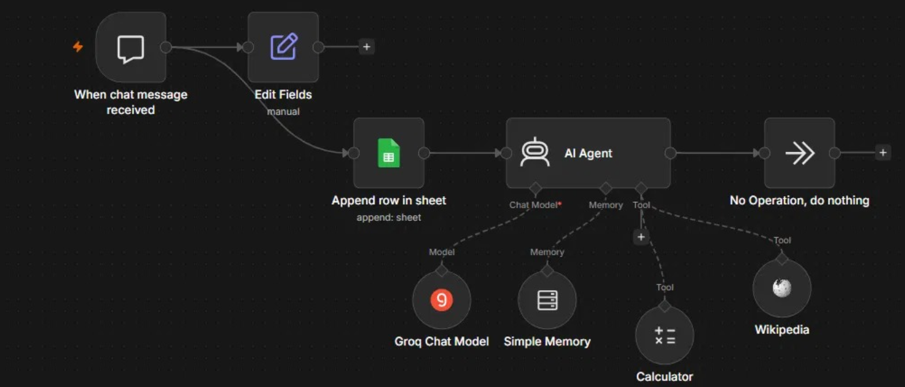
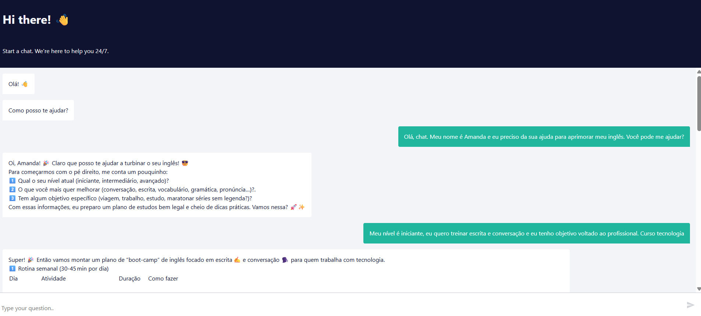

# Agente de Chat com IA no n8n

Um agente de chat que responde pelo chat web do n8n, lembra o que foi dito na conversa e usa ferramentas quando precisa fazer uma conta ou buscar uma informação. Foi aqui que montei a estrutura que uso nos outros projetos: modelo, memória e ferramentas.

**Ferramentas:** n8n, Groq, Google Sheets, Calculator e Wikipedia (tools do LangChain)

## Como funciona

A mensagem chega pelo gatilho de chat do n8n e é registrada numa planilha do Google Sheets (ID da conversa e texto). Depois vai para o AI Agent, que decide se responde direto ou se chama uma ferramenta: a Calculator para contas e a Wikipedia para conceitos e definições. A Simple Memory guarda o histórico da sessão, então o agente lembra o que foi falado antes.

| Node | Função |
|---|---|
| When chat message received | Gatilho do fluxo |
| Edit Fields | Organiza os dados da mensagem |
| Append row in sheet | Salva a conversa no Google Sheets |
| AI Agent | Decide o que fazer e quando usar cada ferramenta |
| Chat Model (Groq) | Gera as respostas |
| Simple Memory | Guarda o histórico por sessão |
| Calculator e Wikipedia | Ferramentas do agente |

## A escolha do modelo

Testei três modelos da Groq até chegar num que funcionasse:

- `groq/compound` não funcionou, porque não aceita ferramentas próprias conectadas ao AI Agent.
- `llama-3.3-70b-versatile` funcionou, mas a Groq descontinuou o modelo.
- `openai/gpt-oss-120b` foi o que ficou: suporta tool calling sem problema.

Foi com isso que entendi que nem todo modelo sabe usar ferramentas, e que vale conferir isso antes de montar o fluxo.

## Prints

Estrutura do workflow:

Exemplo de conversa:

## O que aprendi

- Montar um AI Agent no n8n ligando modelo, memória e ferramentas
- A diferença entre um modelo de linguagem comum e um modelo que já vem como agente pronto, como o Compound
- Usar a aba Executions para descobrir onde o fluxo quebrou
- Nunca publicar credencial, ID de planilha ou token num repositório público

## Como usar

1. Importe o `workflow.json` no n8n (Menu > Import from File)
2. Configure suas credenciais da Groq e do Google Sheets
3. Ative o workflow e clique em "Open chat" para testar

---

Próximo projeto: [Assistente de Estudos via WhatsApp](../assistente-whatsapp-estudos), que leva esta estrutura para o WhatsApp.
